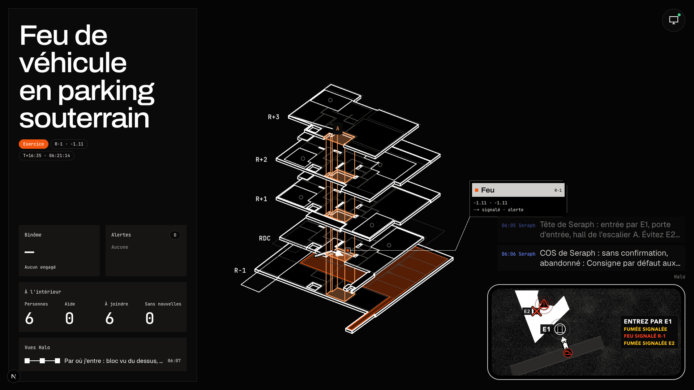
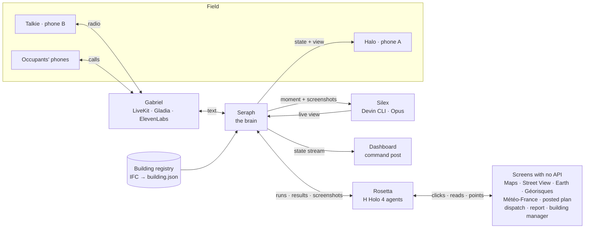
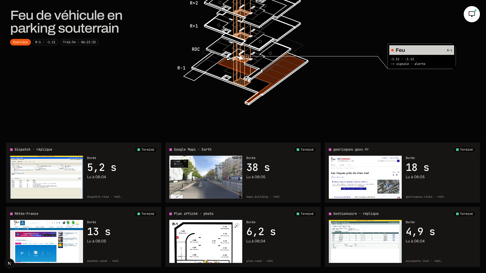

# Seraph

**An AI copilot for firefighters that turns any screen into an API and puts the right information on the
firefighter's wrist, at the right moment, by voice and by image.**

> « Seraph transforme n'importe quel écran en API, et met la bonne information sur le poignet du pompier, au bon
> moment, à la voix et à l'image. »

Built in one night for the **H Company × 42AI computer-use hackathon** (Paris, 7–8 November 2026).
Everything shown is an **EXERCICE**: a fictional incident, fictional occupants, and replicas of the software fire
services use. Nothing touches a real emergency system.



*The command post during a live run. The fire is « signalé · alerte »: reported by the alert centre and not yet
confirmed by the crew. Bottom right, the Halo wrist view that Devin built for this moment.*

---

## The problem

When firefighters are dispatched, the information that would save the most time already exists, on screens they
can't use from a truck: the building on Maps, the plan posted at the door, the risks on Géorisques, the occupant
list in the building manager's software, the 112 calls, the dispatch record. Nobody connects them in time, and
nobody connects them to the people still inside.

At **Grenfell Tower (London, 2017, 72 dead)**, the public inquiry criticised how what callers told the control room
reached the crews, and how decisions such as lifting « stay put » reached the residents. The information existed.
It didn't travel.

## What Seraph does

| While the truck drives | With the people inside | During the attack | At the end |
|---|---|---|---|
| H agents read every screen that matters, live: dispatch, Maps / Street View / Earth, Géorisques, Météo-France, the posted plan, the occupant list | Gabriel calls every occupant and takes the 112 calls, one agent per call, in fr / en / es. Each call becomes a line on the radio and a dot on the building | Halo, a phone on the forearm, shows the one thing that matters now: the way in, who is where, where the fire and smoke are reported. Each view is built for that moment by Devin | The report fills itself in the legacy report software, after the commander confirms |

The commander stays in charge. Seraph proposes on the radio (« Je lui dis de rester chez lui, porte fermée, et
d'aller sur le balcon ? ») and acts only on « Seraph, confirme ».

## The parts

| Part | Role | Folder |
|---|---|---|
| **Seraph** | The brain. Holds the incident state, turns speech and screens into events, runs the safety catches, gates every order through the commander, computes routes in code, decides what Halo shows | `seraph/` |
| **Gabriel** | The voice. One LiveKit agent on the crew radio, one agent per phone call. Listens with Gladia, speaks with ElevenLabs, never decides | `gabriel/` |
| **Rosetta** | Computer use. Our own agent loop on **H's Holo 4** drives real websites and legacy software with no API, points at doors and hydrants on screenshots, and streams its screen to the command post | `rosetta/` |
| **Silex** | Tool creation. Sends each moment to **Devin** (CLI, Claude Opus 5.5), which writes a live Halo view from Rosetta's screenshots and the building plans | `silex/`, `views/` |
| **Halo** | Phone A on the forearm (Expo / React Native). Hosts Devin's views, feeds them live state, shows alerts | `halo/` |
| Talkie | Phone B: push-to-talk crew radio on LiveKit, plus the occupants' web-call page | `talkie/` |
| Dashboard | The command post on the projector: 3D building, radio and calls, gates, Rosetta's six screens, Devin's sessions | `dashboard/` |
| Building registry | Building models looked up by address: the fire service's registry, behind one interface (local, Supabase, or the fire service's own) | `registry/`, `ifc/` |
| Replicas | Old-school web apps with no API, standing for dispatch, report and building-manager software | `replicas/` |



Our own apps talk to each other through normal APIs. **Computer use only ever touches software we don't own**:
that is the point of Rosetta.



*Rosetta's screens during the same run. Each tile is an H agent working a real site or a replica, with its live
duration.*

## What makes it trustworthy

These are product requirements, enforced in code ([docs/07-safety-rules.md](docs/07-safety-rules.md)).

- **The commander decides, Seraph relays.** Any order to occupants, any reroute and sending the report wait for
  « Seraph, confirme » or the dashboard button, and expire after 2 minutes.
- **Code computes positions and routes; models never guess the arrow.** Holo points at things on screenshots. Code
  turns the points into zones and routes on the building graph, avoiding fire and smoke.
- **Nothing is shown before someone reports it.** A fire appears only once the alert centre, a caller or the crew
  reports it, with its source on every screen: « signalé · selon l'appel », then « confirmé · Tête ».
- **Quote, never invent.** A building fact comes from the IFC or a screen, otherwise « pas dans la maquette ».
  A misheard room (« bureau 2.1 ») is resolved against the model or marked « pièce à confirmer ».
- **Public sites read-only, writes only in the replicas.** Rosetta never solves or bypasses a CAPTCHA. A cached
  result is always labelled « cache ».
- **Occupant data only for the incident.** Every read of the occupant list is logged, phone numbers are masked in
  logs, and real calls go only to people who opted in.

## Measured tonight

Measured on one laptop during the night, with small samples. `eval/` collects the full numbers over the rehearsals.

| What | Result |
|---|---|
| Talkie button released → Seraph's first audio on the radio (LiveKit Cloud) | **0.89 – 0.96 s** |
| Radio line → event, rules path / LLM fallback (`gpt-5.4-mini`, no reasoning, priority tier) | **< 1 ms / ~0.8 s** |
| Rosetta live, from the incident start (one run) | dispatch 5.2 s · occupants 4.9 s · plan 6.2 s · Météo-France 13 s · Géorisques 18 s · Maps / Street View / Earth 38 s |
| Devin builds a Halo view (CLI, Opus), checked before serving | **146 – 219 s**, inside the 5-minute drive |
| Tests | Seraph 37 · registry 35 (incl. live Supabase) · the four replica flows pass with Holo 4 |

## The building model

Seraph knows the inside of the building from an **IFC** file, as a fire service would: walls, doors, stairs, rooms,
and materials and fire ratings when the file has them. `ifc/` extracts it once, offline, into a small
`building.json`: a route graph in metres, rooms, doors and level plans. It keeps only what a firefighter needs, with
no furniture or plumbing. The registry finds the right building from the incident's address. In production the
local registry is swapped for the fire service's own through one adapter ([registry/README.md](registry/README.md)).

The demo building is a **real architect's model**: the TU Wien « Real-World Escape Route Test Model »
(CC BY 4.0), registered under an exercise address. It has a single stairwell, with balconies and ladder rescue as the
second way out. That is exactly the case where « stay put » has to be decided flat by flat, and lifted fast.

## Run it

**You need:** Python 3.12 with [uv](https://docs.astral.sh/uv/), Node 24, Google Chrome (Rosetta drives a headed
browser), and optionally the Devin CLI (Silex falls back to Devin's API) and Expo Go on a phone for Halo.

```bash
cp .env.example .env     # fill the keys you have; MOCK=1 runs every service on contracts/fixtures/
```

Each service runs from its own folder:

| Service | Command | Port |
|---|---|---|
| Replicas | `cd replicas && uv run python run.py` | 8101 · 8102 · 8103 |
| Seraph | `cd seraph && uv run seraph` | 8000 |
| Rosetta | `cd rosetta && uv run uvicorn rosetta.app:app --host 0.0.0.0 --port 8001` | 8001 |
| Silex | `cd silex && uv run silex` | 8002 |
| Gabriel | `cd gabriel && uv run gabriel-radio` and `uv run gabriel-calls start` | — |
| Talkie | `cd talkie && npm install && npm run dev` | 3000 |
| Dashboard | `cd dashboard && npm install && npm run dev` (fixtures only: `npm run dev:mock`) | 3002 |
| Halo | `node halo/server.mjs`, then `cd halo/app && npx expo start --lan` and open it in Expo Go | 3001 |

Then start an incident with **D** on the dashboard (or `curl -X POST localhost:8000/incident/start`). **Shift+R**
replays the whole scenario from `contracts/fixtures/`.

Tests: `cd seraph && uv run pytest -q` · `cd registry && uv run pytest -q` · `cd replicas && uv run python tests/flows.py`.

## Honest limits

- **Phone calls are web calls for now.** Real calls through Twilio and LiveKit SIP are planned but not wired, so an
  occupant joins from the web-call page.
- **The replicas stand for real software.** In a deployment, Rosetta would operate the fire service's own dispatch
  and report tools as they are, with no integration.
- **The building model comes from TU Wien,** under an exercise address in Paris. Street View shows the real street,
  not that building.
- Learning a new source live (`/explore`: an H agent finds the answer on screen, then Devin compiles it into a new
  endpoint) is a stretch goal.
- Air tracking for teams under breathing apparatus is cut from this version: teams are tracked by position only.

## How this repo was built

One person and about a dozen Claude Code sessions working in parallel, one folder each, coordinated through
written contracts. [`SYSTEM.md`](SYSTEM.md) is the system on one page. [`CLAUDE.md`](CLAUDE.md) holds the rules and
folder ownership. [`contracts/`](contracts/) holds every message type, endpoint and fixture.
[`briefs/`](briefs/) has each session's job, and [`status/`](status/) what each one built, how to run it, and what it
verified. The design docs are in [`docs/`](docs/): vision, architecture, scenario, the hard parts (Rosetta, Halo,
Gabriel, IFC) and the research behind them.

## Credits

- **Building model:** « Real-World Escape Route Test Model », TU Wien, licensed
  [CC BY 4.0](https://creativecommons.org/licenses/by/4.0/):
  [researchdata.tuwien.ac.at/records/2heb4-xqb83](https://researchdata.tuwien.ac.at/records/2heb4-xqb83).
- **Sponsors, used for real:** [H Company](https://www.hcompany.ai/) (Holo 4 computer-use agents) ·
  [Devin](https://devin.ai/) (builds the Halo views) · [Gladia](https://www.gladia.io/) (speech to text).
- **Also:** LiveKit (radio and calls) · ElevenLabs (voice) · OpenAI (`gpt-5.4-mini` for language) · Supabase
  (registry backend) · IfcOpenShell · Playwright · three.js · Expo.
