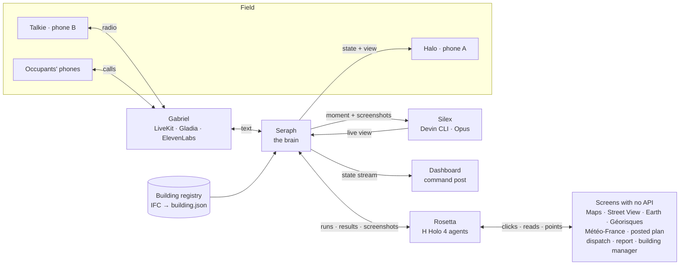

# Seraph

**An AI copilot for firefighters. Seraph turns any screen into an API and puts the right information on the
firefighter's wrist, at the right moment, by voice and by image.**

> « Seraph transforme n'importe quel écran en API, et met la bonne information sur le poignet du pompier, au bon
> moment, à la voix et à l'image. »

[](https://github.com/amilkourd/seraph/actions/workflows/ci.yml)
[](LICENSE)

**See it in your browser: [seraph-rejeu.vercel.app](https://seraph-rejeu.vercel.app).** The command post replays the
exercise from its fixtures, with nothing to install and no key, and a guided tour opens on your first visit.

The repository ships with a complete exercise environment: a fictional incident, fictional occupants and replicas of
the software fire services use, so the whole stack runs end to end without touching a live emergency system.


*The command post during a live run. The fire is « signalé · alerte »: reported by the alert centre and not yet
confirmed by the crew. Bottom right, the Halo wrist view that Devin built for this moment.*

---

## The problem

When firefighters are dispatched, the information that would save the most time already exists, on screens they
can't use from a truck: the building on Maps, the plan posted at the door, the risks on Géorisques, the occupant
list in the building manager's software, the 112 calls, the dispatch record. Nobody connects them in time, and
nobody connects them to the people still inside.

At **Grenfell Tower (London, 2017, 72 dead)**, the public inquiry criticised how what callers told the control room
reached the crews, and how decisions such as lifting « stay put » reached the residents. The information existed.
It didn't travel.

## What Seraph does

| While the truck drives | With the people inside | During the attack | At the end |
|---|---|---|---|
| H agents read every screen that matters, live: dispatch, Maps / Street View / Earth, Géorisques, Météo-France, the posted plan, the occupant list | Gabriel calls every occupant and takes the 112 calls, one agent per call, in fr / en / es. Each call becomes a line on the radio and a dot on the building | Halo, a phone on the forearm, shows the one thing that matters now: the way in, who is where, where the fire and smoke are reported. Each view is built for that moment by Devin | The report fills itself in the legacy report software, after the commander confirms |

The commander stays in charge. Seraph proposes on the radio (« Je lui dis de rester chez lui, porte fermée, et
d'aller sur le balcon ? ») and acts only on « Seraph, confirme ».

## Try it

In your browser, [seraph-rejeu.vercel.app](https://seraph-rejeu.vercel.app) replays the exercise with a guided tour.

The table below drives the live stack. The command post is at `localhost:3002`, phone B is the crew radio, phone A
is Halo. The live stack uses API keys for H, Devin, LiveKit, Gladia and ElevenLabs; the dispatch, report and
occupant systems run as local replicas. On the command post, **X** twice resets and **D** starts the incident.

| Try | Do | You see |
|---|---|---|
| Talk to Seraph | Press **E**, hold the talkie button, say one of the five lines, release | Seraph answers on the radio in about a second. The panel shows what it heard, rules or LLM, the time and its answer |
| A Halo view | « Seraph, il me faut sur Halo le plan du R+3 avec les personnes et la fumée » | Devin builds it in 2–4 minutes: « Vues Halo », then phone A |
| An order | « Seraph, fais le rapport », then « Seraph, confirme » (or **Space**) | Nothing until you confirm. Then Rosetta fills the legacy report software, live (screens: button top right) |
| A 112 call | Open `localhost:3000/call`, talk to Gabriel as a resident, in French, English or Spanish | What you say becomes a line on the radio |
| Your own address | **X** twice, « Nouvelle intervention » in the dispatch replica (`localhost:8101`) with any address in France, then **D** | Within a minute, H agents read Maps, Street View, Earth, Géorisques and Météo-France for it. No model of that building, so « pas de maquette » rather than a guessed plan |
| Replay | **Shift+R** | The whole scripted incident, with a « Rejeu » badge |

Without any API key, in fixture mode (uv and Node 24):

```bash
git clone https://github.com/amilkourd/seraph && cd seraph && cp .env.example .env
cd seraph && uv run pytest -q                        # the brain on the full scenario: 50 tests, no key
cd ../dashboard && npm install && npm run dev:mock   # open localhost:3002: the incident plays from the fixtures
```

## Architecture

| Part | Role | Folder |
|---|---|---|
| **Seraph** | The brain. Holds the incident state, turns speech and screens into events, runs the safety catches, gates every order through the commander, computes routes in code, decides what Halo shows | `seraph/` |
| **Gabriel** | The voice. One LiveKit agent on the crew radio, one agent per phone call. Listens with Gladia, speaks with ElevenLabs, never decides | `gabriel/` |
| **Rosetta** | Computer use. Our own agent loop on **H's Holo 4** drives real websites and legacy software with no API, points at doors and hydrants on screenshots, and streams its screen to the command post | `rosetta/` |
| **Silex** | Tool creation. Sends each moment to **Devin** (CLI, Claude Opus 5.5), which writes a live Halo view from Rosetta's screenshots and the building plans | `silex/`, `views/` |
| **Halo** | Phone A on the forearm (Expo / React Native). Hosts Devin's views, feeds them live state, shows alerts | `halo/` |
| Talkie | Phone B: push-to-talk crew radio on LiveKit, plus the occupants' web-call page | `talkie/` |
| Dashboard | The command post: 3D building, radio and calls, gates, Rosetta's six screens, Devin's sessions | `dashboard/` |
| Building registry | Building models looked up by address: the fire service's registry, behind one interface (local, Supabase, or the fire service's own) | `registry/`, `ifc/` |
| Replicas | Reference dispatch, report and building-manager systems with no API, standing for the fire service's own software | `replicas/` |



Our own services talk to each other through typed HTTP and WebSocket APIs ([contracts/](contracts/)). **Computer use
only ever touches software we don't own**: that is the point of Rosetta.


*Rosetta's screens during the same run. Each tile is an H agent working a real site or a replica, with its live
duration.*

### Voice: LiveKit rooms

| Room | Who is in it | What it carries |
|---|---|---|
| `crew` | Every talkie (identity = call sign, e.g. `Tête`) and Gabriel's radio agent (identity `Seraph`) | The radio: crew transmissions, Seraph's answers, briefings and alerts |
| `call-CALL-W…` | One person on the web-call page and one Gabriel call agent | A web call (talkie `/call`) |
| `call-CALL-P…` | One occupant's phone (SIP) and one Gabriel call agent | An outbound call from Gabriel to an occupant |
| `call-<callee>_<random>` | The caller's phone (SIP) and one Gabriel call agent | An inbound 112 call (LiveKit dispatch rule `seraph-112`) |

A LiveKit token opens one room only. The talkie's `GET /api/token?identity=<call sign>` returns a token for `crew`;
adding `&room=call-…` returns a listen-only, hidden token for that one call, so the commander can listen without the
caller or Gabriel seeing a new participant. Both need the crew access code when `TALKIE_ACCESS_CODE` is set.

## Safety model

These are product requirements, enforced in code ([docs/07-safety-rules.md](docs/07-safety-rules.md)).

- **The commander decides, Seraph relays.** Any order to occupants, any reroute and sending the report wait for
  « Seraph, confirme » or the dashboard button, and expire after 2 minutes.
- **Code computes positions and routes; models never guess the arrow.** Holo points at things on screenshots. Code
  turns the points into zones and routes on the building graph, avoiding fire and smoke.
- **Nothing is shown before someone reports it.** A fire appears only once the alert centre, a caller or the crew
  reports it, with its source on every screen: « signalé · selon l'appel », then « confirmé · Tête ».
- **Quote, never invent.** A building fact comes from the IFC or a screen, otherwise « pas dans la maquette ».
  A misheard room (« bureau 2.1 ») is resolved against the model or marked « pièce à confirmer ».
- **Public sites read-only, writes only in authorised systems.** Rosetta never solves or bypasses a CAPTCHA. A
  cached result is always labelled « cache ».
- **Occupant data only for the incident.** Every read of the occupant list is logged, phone numbers are masked in
  logs, and real calls go only to people who opted in.

## Performance

Measured end to end on a single machine, against LiveKit Cloud, H, Devin and OpenAI.

| What | Result |
|---|---|
| Talkie button released → Seraph's first audio on the radio (LiveKit Cloud) | **0.89 – 0.96 s** |
| Radio line → event, rules path / LLM fallback (`gpt-5.4-mini`, no reasoning, priority tier) | **< 1 ms / ~0.8 s** |
| Rosetta live, from the incident start | dispatch 5.2 s · occupants 4.9 s · plan 6.2 s · Météo-France 13 s · Géorisques 18 s · Maps / Street View / Earth 38 s |
| Devin builds a Halo view (CLI, Opus), checked before serving | **146 – 219 s**, inside the 5-minute drive |
| Test suites | Seraph 50 · registry 35 (incl. live Supabase) · IFC pipeline 29 · the four replica flows pass with Holo 4 |

## The building model

Seraph knows the inside of the building from an **IFC** file, as a fire service would: walls, doors, stairs, rooms,
and materials and fire ratings when the file has them. `ifc/` extracts it once, offline, into a small
`building.json`: a route graph in metres, rooms, doors and level plans. It keeps only what a firefighter needs, with
no furniture or plumbing. The registry finds the right building from the incident's address, and the local registry
is swapped for the fire service's own through one adapter ([registry/README.md](registry/README.md)).

The reference building is a **real architect's model**: the TU Wien « Real-World Escape Route Test Model »
(CC BY 4.0), registered under an exercise address. It has a single stairwell, with balconies and ladder rescue as the
second way out. That is exactly the case where « stay put » has to be decided flat by flat, and lifted fast.

## Getting started

**Requirements:** Python 3.12 with [uv](https://docs.astral.sh/uv/), Node 24, Google Chrome (Rosetta drives a
headed browser), and optionally the Devin CLI (Silex falls back to Devin's API) and Expo Go on a phone for Halo.

```bash
cp .env.example .env     # fill the keys you have; MOCK=1 runs every service on contracts/fixtures/
```

Each service runs from its own folder:

| Service | Command | Port |
|---|---|---|
| Replicas | `cd replicas && uv run python run.py` | 8101 · 8102 · 8103 |
| Seraph | `cd seraph && uv run seraph` | 8000 |
| Rosetta | `cd rosetta && uv run uvicorn rosetta.app:app --host 0.0.0.0 --port 8001` | 8001 |
| Silex | `cd silex && uv run silex` | 8002 |
| Gabriel | `cd gabriel && uv run gabriel-radio` and `uv run gabriel-calls start` | — |
| Talkie | `cd talkie && npm install && npm run dev` | 3000 |
| Dashboard | `cd dashboard && npm install && npm run dev` (fixtures only: `npm run dev:mock`) | 3002 |
| Halo | `node halo/server.mjs`, then `cd halo/app && npx expo start --lan` and open it in Expo Go | 3001 |

Then start an incident with **D** on the dashboard (or `curl -X POST localhost:8000/incident/start`). **Shift+R**
replays the whole scenario from `contracts/fixtures/`.

**With Docker:** one container per backend service (seraph, rosetta, silex, gabriel-radio, gabriel-calls,
replicas, halo); the dashboard and the talkie join with the `web` profile.

```bash
docker compose up --build                  # MOCK=1 docker compose up --build runs it with no API key
docker compose --profile web up --build    # also the dashboard (:3002) and the talkie (:3000)
```

**Tests:** `make test` runs the Seraph, registry and IFC suites; `make typecheck` checks the web apps. The replica
flows run against Holo 4 with `cd replicas && uv run python tests/flows.py`.

## Deployment

- **Fixture mode.** Every service runs with `MOCK=1` on `contracts/fixtures/` and no external call. Every external
  call has a timeout, a cached fallback and a visible state on the command post: a pending panel says what it is
  waiting for, nothing spins forever.
- **Telephony.** Calls run through LiveKit SIP: outbound calls to the building's occupants through the trunk set in
  `LIVEKIT_SIP_OUTBOUND_TRUNK_ID`, inbound 112 calls with the caller's number masked in logs and to Seraph. The
  web-call page (`talkie/`, `/call`) serves occupants when no trunk is configured.
- **Fire-service software.** Rosetta operates dispatch, report and building-manager software through their
  screens, as they are, with no integration project. The exercise environment ships replicas of them
  (`replicas/`).
- **Building models.** The registry resolves a building from the incident's address behind one adapter: local
  files, Supabase, or the fire service's own registry.
- **Access.** The crew radio is protected by a crew access code (`TALKIE_ACCESS_CODE`); the web apps build as
  standalone Next.js apps.
- **Containers.** [docker-compose.yml](docker-compose.yml) runs one container per backend service from the images in
  `docker/`, with health checks, restart policies and named volumes for runtime data.
- **Secrets** come only from environment variables (`.env`, template in [.env.example](.env.example)), passed to
  the containers at run time and never baked into an image. See [SECURITY.md](SECURITY.md).

## Roadmap

- **Learned endpoints.** `/explore`: an H agent finds the answer on a screen it has never seen, then Devin compiles
  it into a new Rosetta endpoint.
- **Breathing-apparatus tracking.** Air supply per team under ARI, on top of the position tracking in place today.

## Repository layout

```
seraph/       the brain: incident state, events, safety catches, commander gate, routing   FastAPI · :8000
gabriel/      voice: crew radio agent, one call agent per phone call                        LiveKit Agents
rosetta/      computer use: endpoints over screens with no API                              H Holo · Playwright · :8001
silex/        tool creation: Halo views and Rosetta endpoints built by Devin                :8002
views/        Halo views built by Silex, served by silex/
halo/         wrist device: view host, live state, alerts                                   Expo · :3001
talkie/       crew push-to-talk radio and occupants' web-call page                          Next.js · :3000
dashboard/    command post: 3D building, radio, calls, gates, agent screens                 Next.js · :3002
registry/     building registry: address → building model                                   local · Supabase · fire service
ifc/          offline IFC pipeline: route graph, level plans, glTF                          IfcOpenShell
replicas/     reference dispatch, report and building-manager systems                       :8101 – 8103
contracts/    message types, endpoints and fixtures shared by every service
docs/         design documents: architecture, scenario, safety rules, research
brand/        visual identity
briefs/       scope of each module
status/       per-module runbook and verification log
docker/       container images: one for every Python service, the Halo kit server, the web apps
setup/        development tooling configuration
tools/        developer utilities
```

## Engineering

- **Contracts first.** Every message type, endpoint and fixture is written in [contracts/](contracts/) before the
  code; services talk only through them.
- **One owner per module.** Each top-level folder is a module with its own runtime, locked dependencies (`uv.lock`,
  `package-lock.json`) and tests ([CODEOWNERS](.github/CODEOWNERS)).
- **Continuous integration** runs the Python test suites and the TypeScript checks on every push and pull request
  ([ci.yml](.github/workflows/ci.yml)).
- **AI-assisted development.** Modules are built by Claude Code sessions, one per folder, under the rules in
  [CLAUDE.md](CLAUDE.md). [SYSTEM.md](SYSTEM.md) is the system on one page; [CONTRIBUTING.md](CONTRIBUTING.md) has
  the workflow.

## License and credits

Seraph is released under the [MIT License](LICENSE).

- **Building model:** « Real-World Escape Route Test Model », TU Wien, licensed
  [CC BY 4.0](https://creativecommons.org/licenses/by/4.0/):
  [researchdata.tuwien.ac.at/records/2heb4-xqb83](https://researchdata.tuwien.ac.at/records/2heb4-xqb83).
- **Built on:** [H Company](https://www.hcompany.ai/) (Holo 4 computer-use agents) ·
  [Devin](https://devin.ai/) (builds the Halo views) · [Gladia](https://www.gladia.io/) (speech to text) ·
  LiveKit (radio and calls) · ElevenLabs (voice) · OpenAI (`gpt-5.4-mini` for language) · Supabase (registry
  backend) · IfcOpenShell · Playwright · three.js · Expo.
