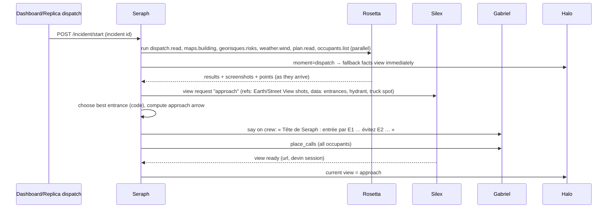
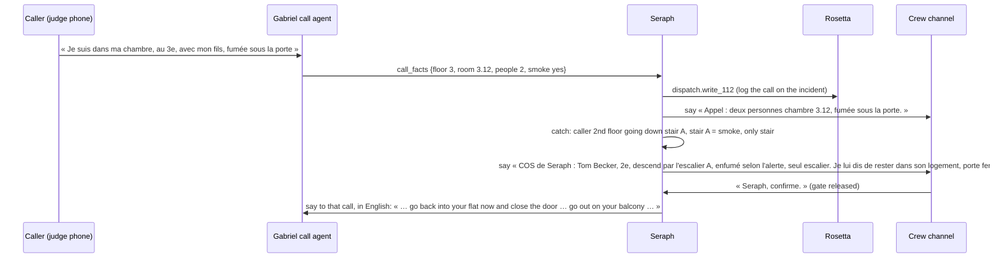

# Architecture

## The picture

```
FIELD                     VOICE                 BRAIN                 COMPUTER USE              SCREENS WITHOUT API
Talkie (phone B) ──audio── Gabriel ──WS──────── Seraph ───HTTP────────── Rosetta ──Playwright──── Géorisques (real)
Occupants' phones ─calls── (LiveKit agents,     (state, events,         (endpoints, own          Google Maps/Earth (real)
Halo (phone A) ◄──views+state── Gladia, TTS,     catches, gate,          Holo agent loop,         Météo-France (real)
                           SIP telephony)       routes, view choice)     pointing, agent cam)     Photo of the door plan
                                                   │   ▲                                          Dispatch (replica)
                                                   ▼   │ view ready / endpoint learned            Report (replica)
                                                 Silex ── Devin API (builds Halo views,           Building manager (replica)
                                                         compiles new Rosetta endpoints)
                                                   │
                                                 Dashboard (projector): everything, live
```

Red line of the product: **our own apps talk by API; Rosetta only touches software we don't own.** Computer use
on our own software would be fake, and the jury would see it.

## Responsibilities

**Seraph (brain, `seraph/`, FastAPI :8000)** — the single source of truth (`contracts/types.ts → IncidentState`).
- Ingests radio transcripts and call facts from Gabriel, results from Rosetta, view/endpoint news from Silex, taps
  from Halo, clicks from the dashboard.
- Extracts structured events from speech (LLM with JSON schema), updates the state, appends to the timeline.
- Runs the **catches** (deterministic rules, see `docs/07-safety-rules.md` and `briefs/seraph.md`).
- Owns the **« confirmez » gate**: any order to occupants, any rerouting, sending the report.
- Computes **positions and routes in code** (graph over entrances → stairs → floors → rooms, avoiding hazards).
- Decides **what Halo should show now** (the "moment") and asks Silex for that view, passing Rosetta's
  screenshots as visual references.
- Tells Gabriel what to say, to whom (crew channel, one call, several calls).
- Streams everything to the dashboard and Halo (SSE).

**Gabriel (voice, `gabriel/`, LiveKit Agents workers)**
- **Radio agent** in LiveKit room `crew` (all firefighters + command): Gladia live STT per speaker, sends each
  push-to-talk utterance to Seraph, speaks Seraph's `say` messages (TTS) when the channel is free.
- **Call agents**: one per phone call, in room `call-<id>`. Incoming 112 calls for the incident (phone number via
  LiveKit SIP + Twilio, or the talkie `/call` web page), and outgoing calls to every occupant from
  `occupants.list`. Each call agent asks the standard questions in the caller's language, sends structured facts to
  Seraph, and says what Seraph tells it (never an order Seraph didn't release through the gate).

**Rosetta (computer use, `rosetta/`, FastAPI :8001)**
- Eight endpoints (`docs/04-rosetta.md`, `contracts/rosetta-endpoints.md`). Each endpoint = a skill run by our own
  agent loop: Holo (H API, OpenAI-compatible) + Playwright browser on the laptop.
- Holo **navigates and points**; code verifies page state and extracts data. Screenshots are stored and returned
  with every result (they become Halo's visual references). Plans: Holo points at named elements, code computes
  zones.
- Streams an **agent cam** (live screenshots + current action) to the dashboard.
- Learning: when Seraph meets a question no endpoint covers, Rosetta runs an exploratory session on screen, and
  Silex turns the trace into a new skill.

**Silex (tool creation, `silex/`, FastAPI :8002 + serves `views/`)**
- Receives a **view request** from Seraph (moment, purpose, data keys, screenshot references, deadline) and starts a
  Devin session that writes a self-contained Halo view (`views/<view_id>/index.html`) using the Halo kit.
- Serves views at `http://localhost:8002/views/<view_id>/`, tells Seraph when ready (with the Devin session link).
- Compiles learned Rosetta endpoints: Devin writes `rosetta/skills/learned/<name>.md` + a test.
- Always respects the deadline: if Devin is late, Seraph keeps Halo on the plain fallback view.

**Halo (`halo/`, Next.js :3001, phone A)** — a shell. Shows the current view in a sandboxed iframe, forwards live
state to it (`postMessage`), forwards taps back to Seraph, shows alerts itself, and has a built-in plain "facts"
fallback view (no Devin needed). Owns the **Halo kit** (`halo/kit/`) that Devin's views use.

**Talkie (`talkie/`, Next.js :3000)** — push-to-talk crew radio on LiveKit (`crew` room) for phone B, plus the
occupant web-call page `/call` (fallback for real phone calls) and `/qr` (judges opt in as occupants).

**Replicas (`replicas/`)** — three old-school web apps with **no API** that stand for systems fire services and
building managers already run: dispatch (:8101), report (:8102), building manager / occupants (:8103).

**Dashboard (`dashboard/`, Next.js :3002)** — the projector: incident header, Halo mirror, crew channel, calls
board, building floor stack, Rosetta agent cams, Silex/Devin sessions, gates with Confirmer, endpoint counter.

## Flows (sequence)

### 1. Dispatch → briefing on the way


### 2. Calls in and out → crew


### 3. A moment → a Halo view
```mermaid
sequenceDiagram
  participant Crew as Crew channel
  participant S as Seraph
  participant X as Silex
  participant Dv as Devin
  participant H as Halo
  Crew->>S: « Binôme 1 engagé, 300 bars »
  S->>S: moment=team_engaged; compute exit_by
  S->>X: view request "ari_tracking" (data: crew.teams)
  X->>Dv: session: build view with Halo kit
  Dv-->>X: views/<id>/index.html
  X-->>S: ready
  S->>H: current view = <id>; state streams in; alarm 5 min before exit_by
```

### 4. Learning a source live
Seraph gets a question no endpoint covers → asks Rosetta `POST /explore` → Linkup finds the official pages → the H agent opens one (visible on agent
cam, ~60–90 s) →
answer spoken (tagged « source non vérifiée ») → Silex has Devin compile the trace into
`rosetta/skills/learned/<name>.md` + test → endpoint counter +1 → next time it is a normal call.

### 5. Report
« Seraph, fais le rapport » → Seraph assembles the timeline → gate « Rapport prêt, confirmez l'envoi » →
`report.fill` through Rosetta in the report replica → done, link on the dashboard.

## Mock mode
Every service starts with `MOCK=1` and only reads `contracts/fixtures/`. `seraph` can replay fixtures
(`POST /admin/replay`), so the dashboard and Halo can be built before voice or computer use works. The demo keeps a
"golden path" cache: each Rosetta endpoint result for the demo address is cached after the first good live run, but
the dashboard always shows whether a result is **live** or **cached**. Never fake agent steps.
